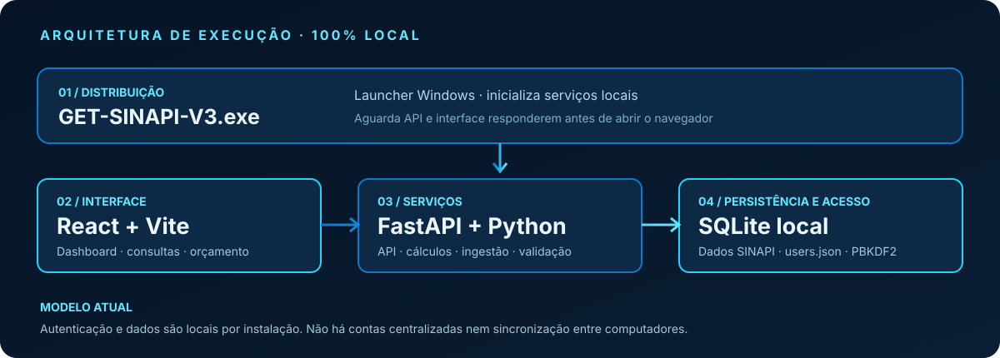

<div align="center">


# GET-SINAPI

### PLATAFORMA DESKTOP · CONSULTA SINAPI · ENGENHARIA DE CUSTOS

Aplicação para Windows que transforma publicações oficiais da CAIXA/SINAPI em consultas, análises, comparações e orçamentos rastreáveis. O projeto também disponibiliza uma ferramenta Python de exportação em lote pelo terminal.


[](https://pypi.org/project/get-sinapi/)

**Dados oficiais. Processamento local. Decisões de engenharia com rastreabilidade.**

[PyPI](https://pypi.org/project/get-sinapi/) · [Releases](https://github.com/nrdataanalysis-1908/GET-SINAPI/releases) · [Código-fonte](https://github.com/nrdataanalysis-1908/GET-SINAPI)

</div>

---

## Versão atual — 3.1.3

A versão 3.1.3 está publicada no PyPI e inclui melhorias na experiência de exportação pelo terminal:

- Exportação otimizada a partir da base SQLite local, com remoção da ordenação global desnecessária.
- Exibição de progresso durante o processamento dos registros, em lotes.
- Exportação para Excel (.xlsx), CSV ou ambos.
- Geração de visão consolidada e arquivos/abas separados por categoria.
- Menu interativo com seleção de competências, UF, regime, encargos e pesquisa.

Instalação/atualização:

```powershell
py -3.13 -m pip install --user --upgrade get-sinapi
getsinapi --version
getsinapi
```

Documentação da distribuição Python: [GET-SINAPI no PyPI](https://pypi.org/project/get-sinapi/).

## Visão geral

O GET-SINAPI reúne uma aplicação desktop Windows e uma ferramenta Python de terminal. A aplicação desktop integra uma interface React, uma API local FastAPI, processamento Python e persistência SQLite. O launcher inicia os serviços na própria máquina e abre a plataforma no navegador padrão; o usuário não precisa iniciar manualmente os servidores.

O produto utiliza o PulseSINAPI como referência de experiência funcional, mas mantém pipeline e regras próprias para ingestão, qualidade, cálculo e rastreabilidade dos dados oficiais.

> **Distribuição:** a aplicação desktop é distribuída como executável Windows. A ferramenta de exportação pelo terminal é disponibilizada separadamente como pacote Python no PyPI. A publicação do pacote Python não transforma a aplicação desktop em um serviço web público.

## Funcionalidades disponíveis na aplicação

- Dashboard com indicadores derivados da base efetivamente carregada.
- Consulta de insumos com pesquisa, filtros e paginação.
- Consulta de composições e detalhamento de componentes e coeficientes.
- Comparação de preços por UF e competência, conforme cobertura disponível.
- Cesta de orçamento e cálculo de totais.
- Histórico das competências presentes na base local.
- Relatórios e exportações disponibilizados pela versão atual.
- Atualização da base com acompanhamento de estado e progresso.
- Integridade, auditoria e informações de origem dos dados.
- Gestão local de contas de acesso.

A disponibilidade de resultados depende das competências e dos arquivos oficiais efetivamente baixados, processados e validados. O sistema não deve apresentar dados ausentes como se fossem preços iguais a zero.

## Capturas e arquitetura

<p align="center">
  
</p>

A arquitetura da distribuição desktop é inteiramente local:

| Componente | Tecnologia | Responsabilidade |
|---|---|---|
| Aplicação desktop | Python / PyInstaller | Inicialização e encerramento dos serviços |
| Interface | React + Vite + TypeScript | Navegação, filtros, tabelas e visualizações |
| API | FastAPI | Consultas, autenticação local e operações |
| Processamento | Python | Coleta, validação, normalização e cálculos |
| Persistência | SQLite | Dados SINAPI e informações locais |
| Autenticação | PBKDF2 + sessão local | Login e controle de contas neste computador |

## Autenticação local

O primeiro acesso permite configurar a conta administradora. O identificador pode ser o e-mail do usuário, acompanhado de uma senha com no mínimo 12 caracteres.

- O primeiro usuário cadastrado recebe o perfil de administrador.
- O administrador pode cadastrar outras contas locais pela área de gestão de acessos.
- As senhas não são armazenadas em texto puro: o backend deriva o hash com PBKDF2-HMAC-SHA256 e salt individual.
- A sessão local tem duração de até oito horas.
- Os registros de autenticação são mantidos no arquivo `security/users.json`, dentro do diretório de dados da aplicação.

**Limite importante:** as contas são locais e pertencem ao diretório de dados daquele computador. Cadastrar usuários em uma instalação não cria automaticamente contas nas instalações dos demais engenheiros. Ainda não há login centralizado, revogação remota, sincronização de contas ou compartilhamento central de orçamentos.

## Armazenamento e diretório de dados

A aplicação utiliza SQLite local. O diretório de dados pode ser definido por configuração de ambiente; na distribuição desktop, o launcher prepara o ambiente de execução e mantém logs locais.

Não compartilhe o arquivo de banco ou o diretório de autenticação contendo dados operacionais sem avaliar previamente as implicações de segurança e consistência. Para vários engenheiros trabalharem com a mesma base e os mesmos orçamentos, será necessária uma camada de sincronização central — não faz parte do modelo atual.

## Instalação da aplicação desktop

1. Baixe o pacote Windows disponibilizado na área de [Releases](https://github.com/nrdataanalysis-1908/GET-SINAPI/releases) ou no artefato de build autorizado.
2. Extraia o ZIP em uma pasta local.
3. Execute `GET-SINAPI-V3.exe`.
4. No primeiro acesso, configure o usuário administrador e a senha.
5. Nos acessos seguintes, entre com as credenciais locais.

O launcher inicia a API e o frontend localmente, aguarda os serviços responderem e então abre a interface no navegador padrão.

## Exportação em lote pelo terminal

O pacote Python `get-sinapi` disponibiliza a interface de terminal pelo comando `getsinapi`. O menu interativo permite selecionar:

- Todas as categorias ou apenas insumos, composições e componentes.
- Uma competência específica ou todas as competências carregadas.
- Uma UF específica ou todas as UFs disponíveis.
- Regime de desoneração e modalidade de encargos.
- Pesquisa por código ou descrição.
- Saída em Excel (.xlsx), CSV ou nos dois formatos.

A exportação completa gera uma visão consolidada com os registros selecionados e arquivos/abas individualizados por categoria. No Excel, o consolidado e cada categoria ficam em abas próprias; no CSV, são gerados um arquivo consolidado e arquivos separados por categoria. Os CSVs usam UTF-8 com BOM e delimitador ponto e vírgula para melhor abertura no Excel em configurações regionais brasileiras.

### Instalação e execução

A versão 3.1.3 está disponível no PyPI:

```powershell
py -3.13 -m pip install --user --upgrade get-sinapi
getsinapi
```

Para abrir diretamente o fluxo de exportação:

```powershell
getsinapi export
```

O comando consulta a base SQLite local já carregada; não refaz o download dos pacotes oficiais a cada exportação. Na instalação desktop, utiliza o mesmo diretório de dados configurado pelo launcher. Em instalações independentes, defina `GETSINAPI_DATABASE_PATH` para apontar ao arquivo `getsinapi.sqlite3` correto. A funcionalidade de terminal não substitui nem altera o executável Windows.

### Comportamento da exportação

- A leitura é realizada em lotes para controlar o consumo de memória.
- O terminal informa a quantidade de registros processados durante a geração dos arquivos.
- A exportação usa a base SQLite local e respeita os filtros selecionados.
- Os arquivos são direcionados à pasta Downloads do usuário.

## Desenvolvimento local

Requisitos: Python 3.11+ e Node.js 20+.

### Serviço de aplicação

```powershell
py -3.11 -m venv .venv
.\.venv\Scripts\Activate.ps1
python -m pip install --upgrade pip
pip install -e ".[dev]"
$env:GETSINAPI_DATABASE_PATH = "data/getsinapi.sqlite3"
uvicorn getsinapi.api.main:app --reload
```

API local: `http://127.0.0.1:8000`  
Health check: `http://127.0.0.1:8000/api/health`  
Documentação OpenAPI: `http://127.0.0.1:8000/docs`

### Interface

Em outro terminal:

```powershell
cd frontend
npm install
npm run dev
```

Frontend de desenvolvimento: `http://localhost:5173`. O Vite encaminha as chamadas `/api` para a API local.

### Qualidade e testes

```powershell
ruff check .
pytest -v
```

O workflow Windows compila o frontend, empacota a aplicação com PyInstaller e executa um smoke test da interface e do endpoint de saúde antes de publicar o artefato.

## Pipeline e integridade dos dados

| Camada | Responsabilidade |
|---|---|
| Bronze | Preservação dos pacotes oficiais recebidos |
| Staging | Extração controlada e inventário dos arquivos |
| Silver | Normalização, tipagem e validação |
| Gold | Estruturas consolidadas para consulta e análise |
| Aplicação | Consulta, comparação, cálculo e orçamento |

Princípios:

- Publicações oficiais da CAIXA como fonte de referência.
- Nenhum dado sintético em produção.
- Distinção entre zero publicado, valor ausente e falha de extração.
- Preservação de competência, UF, regime e origem.
- Valores monetários e coeficientes tratados com precisão decimal.
- Atualizações incrementais e idempotentes, preservando o histórico válido.
- Rastreabilidade até publicação, arquivo e referência de origem, conforme metadados disponíveis.

## Cobertura e limitações conhecidas

- A cobertura histórica depende dos pacotes efetivamente publicados, coletados e processados.
- Os layouts legados anteriores a 2025 exigem tratamento específico; não se deve presumir cobertura histórica integral.
- O armazenamento da aplicação desktop é SQLite local.
- A autenticação é local, sem provedor externo.
- Não há sincronização de dados ou orçamentos entre computadores.
- A distribuição desktop atual é Windows; uma versão web hospedada não faz parte do escopo vigente.

## Stack tecnológica

Python · React · TypeScript · Vite · FastAPI · SQLite · SQLAlchemy · Pandas · Pytest · Ruff · PyInstaller · GitHub Actions.

## Licença e dados de terceiros

O código-fonte é distribuído sob a licença MIT, conforme o arquivo [LICENSE](LICENSE). Essa licença não altera os direitos, termos de uso ou atribuição aplicáveis às publicações, marcas e dados de terceiros, incluindo os dados oficiais do SINAPI.

---

<div align="center">

**GET-SINAPI**  
NR TECH · Engenharia de Dados e Custos

*Precisão na origem. Consistência no processamento. Confiança na consulta.*

</div>
