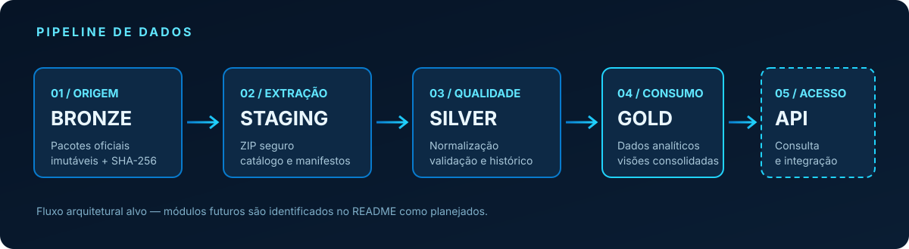

<div align="center">


# GET-SINAPI

### ENGENHARIA DE DADOS · INTELIGÊNCIA DE CUSTOS · CONSTRUÇÃO CIVIL

Pipeline para coleta, validação, normalização e disponibilização de dados oficiais do SINAPI.


**Dados oficiais. Engenharia rastreável. Inteligência para decisões.**

</div>

---

## Visão do produto

O GET-SINAPI é uma plataforma de engenharia de dados concebida para transformar publicações mensais do SINAPI em conjuntos estruturados, verificáveis e consultáveis.

A solução foi projetada para preservar a origem de cada informação, manter o histórico por competência e UF e distinguir corretamente preços, custos, coeficientes, encargos e situações de disponibilidade.

O objetivo é oferecer uma fundação confiável para análises de custos, composição de orçamentos, comparação histórica e integração com sistemas de engenharia.

## Capacidades da plataforma

<table>
<tr>
<td width="50%">

### Coleta e ingestão
- Descoberta e download de pacotes oficiais.
- Validação do arquivo recebido.
- Identificação por competência.
- Cálculo de SHA-256.
- Manifestos de coleta.

</td>
<td width="50%">

### Extração e catalogação
- Extração controlada de arquivos ZIP.
- Proteção contra path traversal.
- Inventário de workbooks e abas.
- Registro de dimensões e metadados.
- Separação entre origem e staging.

</td>
</tr>
<tr>
<td width="50%">

### Tratamento e qualidade
- Normalização de valores e textos.
- Interpretação de preços e estados.
- Validação de registros.
- Preservação de ausências e zeros.
- Rastreabilidade de rejeições.

</td>
<td width="50%">

### Consulta e inteligência
- Histórico por competência e UF.
- Consulta de insumos e composições.
- Comparativos de custos.
- Exportações analíticas.
- API e integração com aplicações.

</td>
</tr>
</table>

> **Transparência de implementação:** a branch `v2/development` passou a incorporar uma interface modular com painel executivo, catálogo com filtros combináveis, explorador de composições, comparador de preços por UF, cesta de orçamento, histórico das competências já carregadas, exportação CSV/JSON e autenticação local com hash PBKDF2. Esses módulos utilizam os dados persistidos no SQLite e os serviços já existentes na API. Isso não significa que todo o acervo histórico da CAIXA esteja coletado: o histórico exibido corresponde somente às competências efetivamente carregadas. A descoberta e homologação do download oficial, exportação Excel/PDF, gestão de múltiplas contas, auditoria criptográfica em interface e cobertura histórica integral ainda exigem implementação e validação.

## Arquitetura de dados

<p align="center">
  
</p>

| Camada | Responsabilidade | Diretriz |
|---|---|---|
| Bronze | Pacotes oficiais originais | Imutabilidade, checksum e proveniência |
| Staging | Extração temporária | Isolamento por competência e execução |
| Silver | Dados normalizados | Tipagem, validação e rastreabilidade |
| Gold | Dados consolidados | Consulta, análise e integração |
| API | Acesso programático | Contratos explícitos e filtros |

## Dados SINAPI contemplados no modelo

A auditoria dos arquivos oficiais XLSX identificou estruturas para:

| Domínio | Conteúdo |
|---|---|
| Insumos | Código, descrição, unidade, classificação e origem do preço |
| Preços | Valores por UF, competência e relatório de referência |
| Composições | Cadastro, grupo, descrição, unidade e situação |
| Itens de composição | Insumos, composições subordinadas e coeficientes |
| Custos | Custos publicados por UF e modalidade de encargos |
| Mão de obra | Valores por composição, UF e condição de desoneração |
| Coeficientes técnicos | Famílias, itens, categorias e coeficientes por UF |
| Manutenções | Eventos de criação e atualização publicados pela fonte |

A modelagem distingue regime de desoneração de modalidade de encargos sociais. Também preserva preço informado como zero, informação ausente e item não pesquisado como estados distintos.

## Princípios de integridade

- Fonte oficial como autoridade dos dados publicados.
- Nenhum dado sintético ou preenchimento artificial em produção.
- Histórico preservado por competência.
- Reprocessamento idempotente.
- Valores monetários e coeficientes com precisão decimal.
- Códigos oficiais preservados como identificadores.
- Proveniência até arquivo, planilha e linha de origem.
- Situação oficial preservada também em cada componente de composição.
- SHA-256, tamanho e contagem dos três artefatos Silver verificados antes da carga SQLite.
- Extração segura e validação de integridade dos arquivos.
- Separação entre dado oficial e cálculo derivado pelo sistema.

## Instalação e desenvolvimento

Requisitos: Python 3.11 ou superior.

~~~powershell
git clone https://github.com/nrdataanalysis-1908/GET-SINAPI.git
cd GET-SINAPI

py -3.11 -m venv .venv
.\.venv\Scripts\Activate.ps1

python -m pip install --upgrade pip
pip install -e ".[dev]"
~~~

### Verificação de qualidade

~~~powershell
ruff check .
pytest -v
~~~

### Coleta por competência

~~~powershell
getsinapi download --reference 2026-09
~~~

### Extração do pacote

~~~powershell
getsinapi extract --archive "data\raw\SINAPI-2026-09-formato-xlsx.zip" --reference 2026-09
~~~

Os nomes efetivos dos arquivos devem corresponder ao pacote baixado e ao manifesto gerado.

## Stack tecnológica

<p align="center">
  
  
  
  
  
  
  
  
</p>

A stack acima representa tecnologias incorporadas ou previstas na arquitetura. A presença de um componente na lista não significa que todos os módulos estejam integrados ou publicados na versão atual.

## Evolução do produto

| Frente | Situação |
|---|---|
| Fundação Python, CLI e configuração | Implementada |
| Coleta e validação inicial de pacotes | Implementação inicial |
| Extração segura e catálogo XLSX | Implementada |
| Auditoria dos layouts oficiais | Em andamento |
| Parsers de preços ISD/ICD/ISE e relatório Analítico | Implementação inicial |
| Motor de cálculo recursivo de composições e orçamento | Implementação inicial |\n| Persistência histórica SQLite e carga idempotente | Implementação inicial |
| API FastAPI de consulta, agregações e orçamento | Implementação inicial |
| Aplicação React/Vite modular (dashboard, catálogo, composição, comparação e orçamento) | Implementação inicial na V2 |
| Launcher desktop Windows e empacotamento PyInstaller | Build automatizado; execução final em homologação |
| Homologação do download automático no catálogo CAIXA | Pendente de validação externa |
| PostgreSQL, mapas e análises adicionais | Fora do escopo local atual / planejado |
| Login local PBKDF2 e exportação CSV/JSON | Implementação inicial na V2 |\n| Exportação XLSX/PDF, gestão de usuários e auditoria visual SHA-256 | Planejado |

## Licença e uso dos dados

O código-fonte do GET-SINAPI é distribuído sob a licença MIT. Consulte o arquivo [LICENSE](LICENSE).

A licença do software não altera os direitos, termos de uso ou condições aplicáveis aos arquivos, marcas e dados de terceiros. Os dados oficiais permanecem atribuídos às respectivas fontes.

---

<div align="center">

**GET-SINAPI**  
NR TECH · Data Engineering

*Precisão na origem. Consistência no processamento. Confiança na consulta.*

</div>

## Aplicação web (React + FastAPI)

A aplicação desktop combina frontend React/Vite, API FastAPI e persistência SQLite local. O painel apresenta indicadores derivados do banco, distribuição de observações por UF, série histórica, composição por tabela, pesquisa paginada de insumos e composições, cálculo recursivo e orçamento.

O launcher Windows inicia os serviços em `127.0.0.1`, abre a interface no navegador padrão e mantém os dados em `%LOCALAPPDATA%\NRDataAnalysis\GET-SINAPI\data`. A primeira execução pode iniciar a descoberta e a ingestão em segundo plano. O estado do bootstrap é registrado em `data/logs/bootstrap-state.json`.

### Iniciar a API em desenvolvimento

Na raiz do projeto, com o ambiente virtual ativado:

```powershell
pip install -e ".[dev]"
$env:GETSINAPI_DATABASE_PATH = "data/getsinapi.sqlite3"
uvicorn getsinapi.api.main:app --reload
```

A API ficará disponível em `http://127.0.0.1:8000`; a verificação de saúde está em `/api/health` e a documentação OpenAPI em `/docs`.

### Iniciar o frontend

Em outro terminal:

```powershell
cd frontend
npm install
npm run dev
```

Abra `http://localhost:5173`. O Vite encaminha as chamadas `/api` para a API local na porta 8000. Para consultas com dados, configure o banco SQLite por `GETSINAPI_DATABASE_PATH` ou execute a carga Silver antes de abrir o painel.

> Limites atuais: o armazenamento é SQLite local; login local e exportações CSV/JSON foram incorporados à V2. Ainda não há exportação XLSX/PDF, gestão de usuários pela interface, mapas geográficos, sincronização PostgreSQL nem ingestão integral de todas as competências históricas. A atualização automática depende de homologação do acesso real aos arquivos publicados pela CAIXA.
